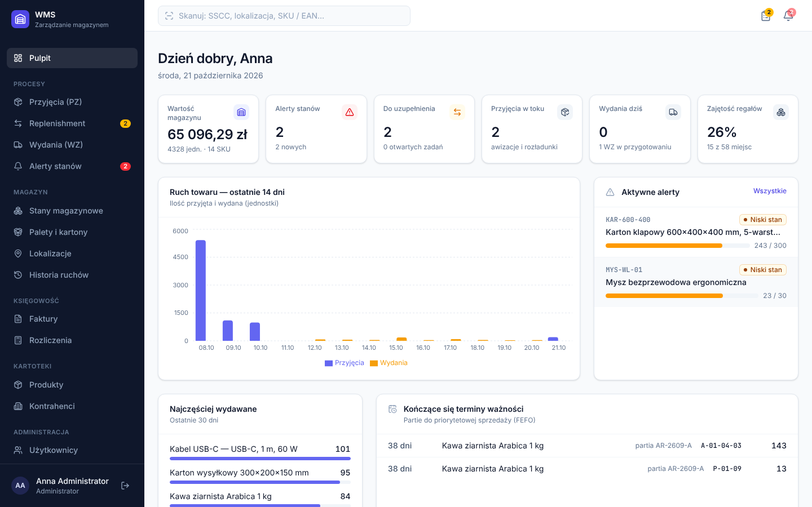
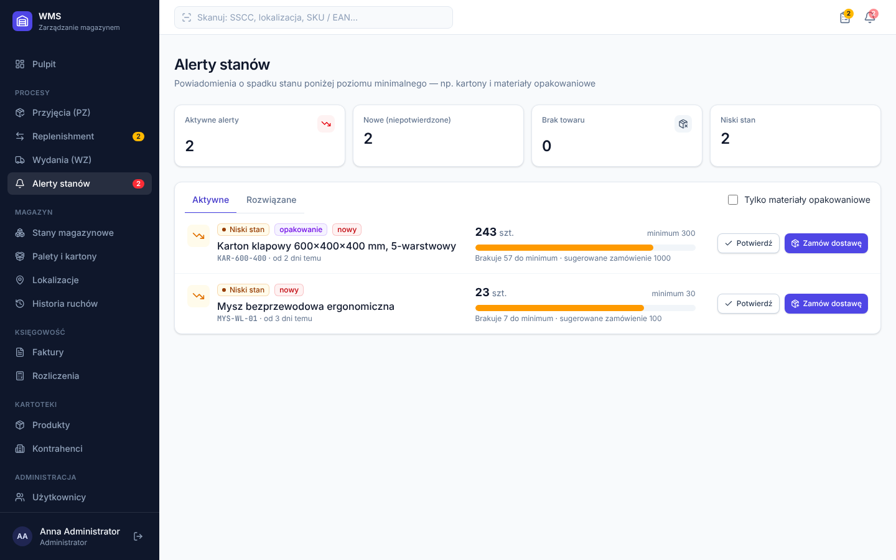
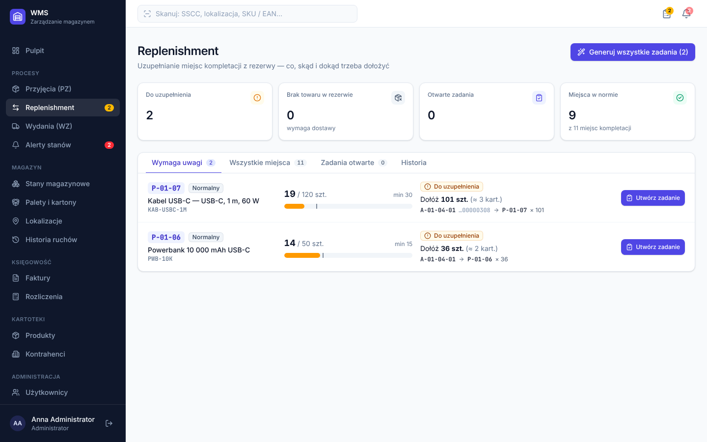
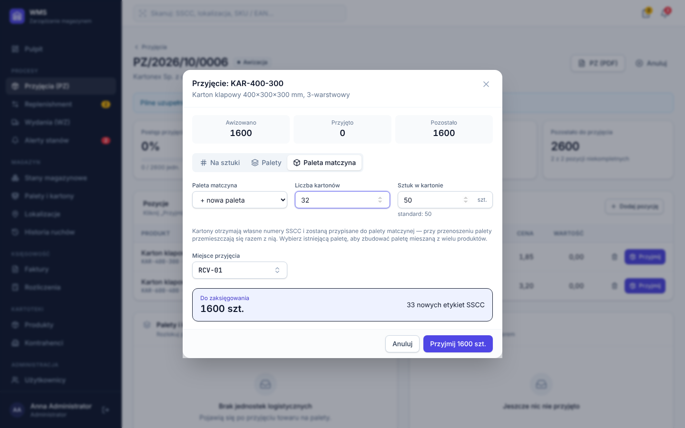
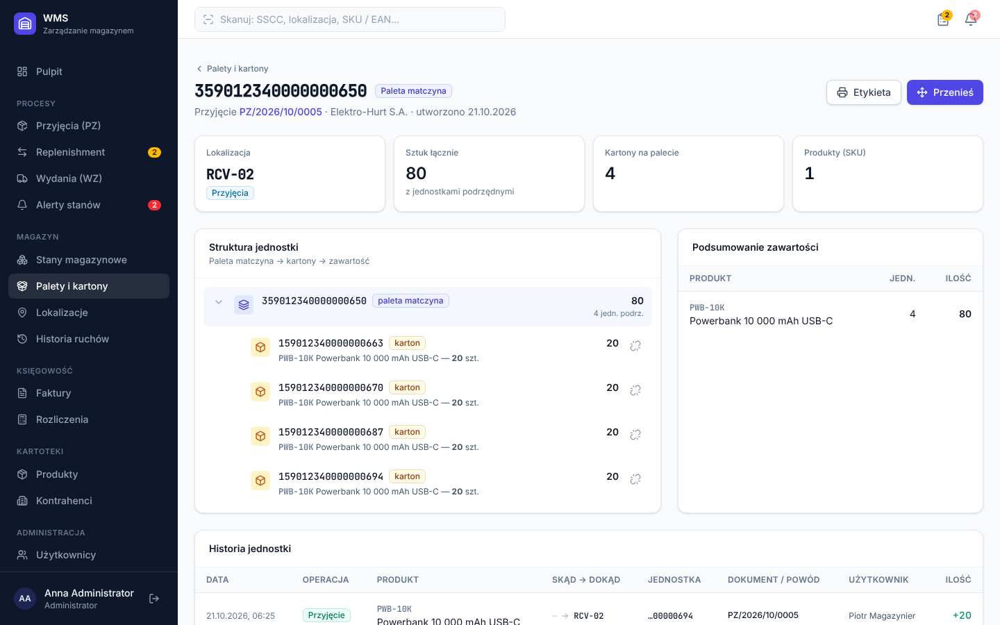
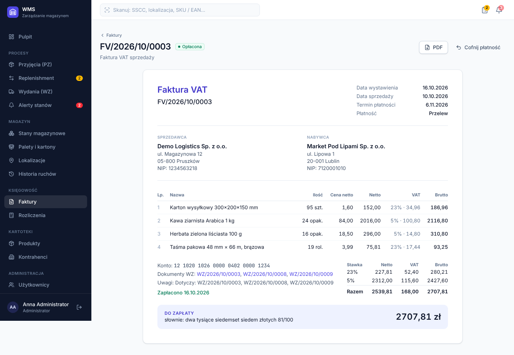
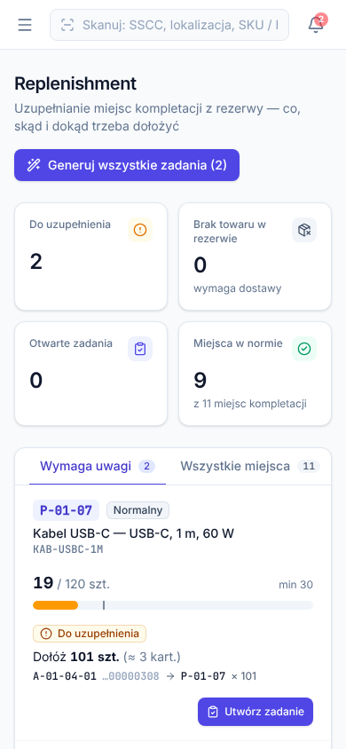

# WMS — system zarządzania magazynem

Pełnostackowa aplikacja WMS (Warehouse Management System) obejmująca cały obieg towaru: od awizacji dostawy, przez przyjęcie na sztuki lub palety (z paletami matczynymi i kartonami), rozlokowanie, uzupełnianie miejsc kompletacji, aż po wydanie WZ, fakturę VAT i zestawienia dla księgowości.



**Stack:** TypeScript · NestJS 11 · Prisma 6 · PostgreSQL 16 · React 19 · TanStack Query · Tailwind CSS 4 · Vite · Jest + Supertest · Docker · GitHub Actions

---

## Najważniejsze funkcje

### 🔔 Alerty stanów minimalnych
- Każdy produkt ma **próg minimalny** (np. kartony 600×400×400 → 300 szt.). Spadek poniżej generuje alert `Niski stan`, a zejście do zera alert `Brak towaru`.
- Alerty są przeliczane **automatycznie po każdej operacji** zmieniającej stan: przyjęciu, wydaniu, korekcie czy zużyciu wewnętrznym kartonów do pakowania.
- Powiadomienia trafiają **na żywo** (Server-Sent Events) jako toast i licznik w menu.
- Alert rozwiązuje się sam, gdy stan wróci powyżej minimum. Eskalacja z „niskiego stanu” do „braku” wymaga ponownego potwierdzenia.
- Przycisk **„Zamów dostawę”** tworzy awizację PZ z sugerowaną ilością zamówienia.



### 🔁 Replenishment — co i gdzie trzeba dołożyć
- Każde miejsce kompletacji ma parametry **min / max**. Gdy stan spadnie do minimum, system wylicza ilość potrzebną do uzupełnienia do maksimum.
- Źródło jest wybierane z rezerwy według **FEFO** (najkrótsza data ważności, potem FIFO). Kilka kartonów z tej samej palety jest scalanych w jedno zadanie.
- Ilości z otwartych zadań są uwzględniane, więc zadania się nie dublują.
- Statusy: *Do uzupełnienia*, *Brak w rezerwie* (z linkiem do zamówienia), *Zadanie w toku*, *OK*. Priorytety: pilne / wysoki / normalny.
- Zadania można wygenerować jednym kliknięciem, a magazynier potwierdza je z faktycznie przeniesioną ilością.



### 📦 Przyjęcie towaru — na sztuki i palety, palety matczyne
Trzy tryby przyjęcia na jednym ekranie:

| Tryb | Opis |
|---|---|
| **Na sztuki** | Luzem w lokalizacji lub dołożone na istniejącą paletę z dostawy |
| **Palety** | N palet jednorodnych po X sztuk; każda paleta dostaje własny numer SSCC |
| **Paleta matczyna** | Paleta z K kartonami po Y sztuk; kartony mają własne SSCC i są przypięte do palety matczynej. Na tę samą paletę można dołożyć kolejne produkty (paleta mieszana) |

- Numery **SSCC (GS1, 18 cyfr) z cyfrą kontrolną** i etykiety A6 z kodem kreskowym **GS1-128** w PDF.
- Widok palety pokazuje **drzewo zawartości** (paleta matczyna → kartony → produkty) i liczbę sztuk na każdym poziomie.
- Przeniesienie palety przenosi całe drzewo. Kontrolowana jest pojemność lokalizacji (np. 1 paleta na miejsce regałowe).
- Kontrola zgodności z awizacją: nadwyżki i braki pokazywane per pozycja i na dokumencie PZ.
- Ewidencja **partii i dat ważności** (wymagana dla wybranych produktów).




### 🧾 Rozliczenia dla księgowości: faktury i WZ
- **WZ (wydanie zewnętrzne)**: pobranie FEFO (najpierw strefa kompletacji, potem rezerwa), zapis miejsc pobrania, wycena po **średnim ważonym koszcie zakupu** oraz storno zwracające towar na te same miejsca i palety.
- **Faktura VAT sprzedaży** do jednego lub wielu WZ tego samego odbiorcy (pozycje są agregowane) albo ręczna, np. za usługi magazynowe.
- **Faktura zakupowa** rozliczana z PZ, z wykazaną różnicą cenową między fakturą a przyjęciem.
- VAT liczony od sumy netto w każdej stawce (art. 106e ustawy o VAT) i **kwota słownie** z poprawną odmianą („dwa tysiące… złote 81/100”).
- Zestawienia: VAT należny i naliczony per stawka, VAT do zapłaty, marża na WZ, należności i zobowiązania (w tym przeterminowane), lista WZ do zafakturowania i PZ bez faktury.
- Eksport **rejestru VAT** i **rejestru PZ/WZ** do CSV w formacie dla polskiego Excela (`;`, przecinek dziesiętny, BOM).
- Dokumenty PDF: faktura, WZ, PZ, etykiety palet.



### Pozostałe
- Stany magazynowe per produkt i strefa, per lokalizacja i paleta, terminy ważności. Wartość magazynu.
- Mapa lokalizacji z zajętością i generator siatki regałów (`A-01-02-03`).
- Pełna **historia ruchów** (kto, co, skąd, dokąd, dokument, powód).
- Korekty inwentaryzacyjne i zużycie wewnętrzne z powodem.
- Globalne pole **skanera**: SSCC, kod lokalizacji, SKU lub EAN przenosi od razu do właściwego widoku.
- Role: **Administrator, Kierownik, Magazynier, Księgowość**, egzekwowane po stronie API.
- Responsywny interfejs dla magazyniera pracującego na telefonie lub terminalu.

<p align="center"></p>

---

## Uruchomienie

### Docker (najszybciej)
```bash
docker compose up --build
```
Aplikacja: **http://localhost:3000** · dokumentacja API (Swagger): **http://localhost:3000/api/docs**

Przy pierwszym starcie kontener wykonuje migracje i ładuje dane demonstracyjne.

### Lokalnie
Wymagania: Node.js 22, pnpm 10, PostgreSQL 16.

```bash
pnpm install
cp apps/api/.env.example apps/api/.env      # ustaw DATABASE_URL
pnpm db:migrate                              # migracje
pnpm db:seed                                 # dane demo (--force czyści bazę)
pnpm dev                                     # API :3000 + frontend :5173
```

### Konta demonstracyjne
| Rola | E-mail | Hasło |
|---|---|---|
| Administrator | admin@wms.local | admin123 |
| Kierownik magazynu | kierownik@wms.local | demo1234 |
| Magazynier | magazynier@wms.local | demo1234 |
| Księgowość | ksiegowa@wms.local | demo1234 |

Dane demo powstają **przez serwisy domenowe**, a nie surowe INSERT-y. Obejmują 14 dni historii, dostawy z paletami matczynymi, wydania, zużycie kartonów (aktywne alerty), uzupełnienia, faktury i otwarte procesy: przyjęcie w trakcie, awizację i szkic WZ.

---

## Testy

```bash
pnpm test          # jednostkowe + e2e
```

- **Jednostkowe** (26): VAT i zaokrąglenia, kwota słownie, SSCC i cyfra kontrolna GS1, FEFO, logika replenishmentu, średni ważony koszt, CSV.
- **E2E na prawdziwym PostgreSQL** (14): pełny proces PZ (paleta matczyna + sztuki) → putaway z kontrolą pojemności → replenishment → WZ (FEFO) → alerty → storno → faktury → księgowość → CSV, a do tego uprawnienia ról i **test wyścigu**: dwa równoległe WZ na ten sam towar, z których dokładnie jeden przechodzi.

CI (GitHub Actions) uruchamia typecheck, testy z usługą PostgreSQL i build.

---

## Architektura

```
apps/
├── api/                      NestJS + Prisma
│   ├── prisma/               schemat, migracje, seed
│   ├── src/
│   │   ├── inventory/        StockService — silnik stanów (jedyne miejsce zmian stanu)
│   │   ├── receipts/         PZ: awizacja, przyjęcie 3 trybami, zamknięcie
│   │   ├── handling-units/   palety / kartony, drzewo, przeniesienia, etykiety
│   │   ├── replenishment/    wyliczenia min/max + zadania
│   │   ├── issues/           WZ: FEFO, wycena, storno
│   │   ├── invoices/         faktury sprzedaży / zakupu
│   │   ├── accounting/       zestawienia VAT, eksport CSV
│   │   ├── alerts/           alerty stanów minimalnych
│   │   ├── events/           Server-Sent Events (live update)
│   │   ├── pdf/              faktura, WZ, PZ, etykiety GS1-128
│   │   └── common/utils/     czyste funkcje domenowe (+ testy)
│   └── test/                 e2e
└── web/                      React SPA (Vite, TanStack Query, Tailwind)
```

### Decyzje projektowe
- **Jedno miejsce zmiany stanów.** Każda operacja przechodzi przez `StockService.run()`: transakcję z ponowieniem przy konflikcie, zapis ruchu (audyt), przeliczenie alertów i zdarzenie SSE po zatwierdzeniu.
- **Brak ujemnych stanów przy współbieżności.** Zdjęcie ze stanu to warunkowy `UPDATE … WHERE quantity >= n` (atomowo, bez blokad aplikacyjnych). Dodatkowo w bazie działa `CHECK (quantity >= 0)`.
- **Atomowy upsert stanów.** Rekord stanu ma deterministyczny klucz `produkt|lokalizacja|jednostka|partia|ważność`.
- **Jeden aktywny alert na produkt** gwarantowany przez częściowy indeks unikalny w PostgreSQL.
- **Numeracja dokumentów** (`PZ/2026/10/0001`) przez `INSERT … ON CONFLICT DO UPDATE … RETURNING`, bez luk i duplikatów przy równoległych żądaniach.
- **Kwoty w groszach (Int).** Ani jednej liczby zmiennoprzecinkowej w obliczeniach finansowych.
- **Wycena magazynu średnią ważoną**, a koszt jest zamrażany na pozycji WZ w chwili wydania, co daje poprawną marżę historyczną.
- **Hierarchia jednostek logistycznych** (self-relation), z przenoszeniem drzewa i automatycznym statusem `EMPTY`.

---

## API

Pełna dokumentacja OpenAPI: `/api/docs`. Przykładowe endpointy:

```
POST /api/receipts/:id/receive        przyjęcie (PIECE | PALLET | MIXED_PALLET)
POST /api/handling-units/:id/move     przeniesienie palety z całą zawartością
GET  /api/replenishment               co i gdzie dołożyć
POST /api/replenishment/generate      generowanie zadań
POST /api/issues/:id/confirm          wydanie FEFO
POST /api/invoices/from-issues        faktura do WZ
GET  /api/accounting/summary          zestawienie VAT / marża / należności
GET  /api/accounting/export/invoices  rejestr VAT (CSV)
GET  /api/events?token=…              strumień zdarzeń (SSE)
```

## Możliwe rozszerzenia
- Inwentaryzacja z arkuszami spisowymi i zamrożeniem lokalizacji
- Faktury korygujące, integracja z KSeF
- Zamówienia sprzedażowe z rezerwacją stanu i falami kompletacji
- Skanowanie kodów aparatem telefonu (BarcodeDetector API)
- Powiadomienia e-mail o alertach
